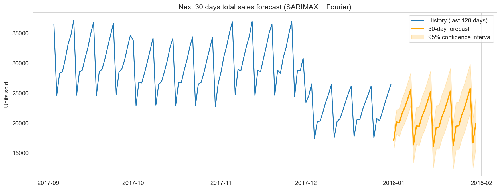

Retail Demand Forecasting (Time Series)

Forecasting total daily retail sales with classical time series models in Python.

Dataset: [Store Item Demand Forecasting Challenge](https://www.kaggle.com/c/demand-forecasting-kernels-only) (Kaggle) - 5 years of daily sales (2013-2017), 10 stores, 50 items, 913,000 rows.

Business problem
Retailers need to know how many units they will sell so they can plan inventory and staffing. This project forecasts total daily demand for the next 30 days.

Approach
1. EDA - trend, weekly and yearly seasonality, store and item comparison
2. Decomposition - weekly (period 7) and yearly (period 365)
3. Stationarity - rolling statistics, ADF test, first-order differencing, ACF / PACF
4. Models - Naive, Seasonal Naive, AR(7), MA(7), ARIMA(2,1,2), SARIMA, SARIMAX with Fourier terms (yearly seasonality)
5. Evaluation - 90-day hold-out set, MAPE / RMSE / MAE
6. Validation - walk-forward validation (4 folds x 30 days) and residual diagnostics (Ljung-Box)
7. Forecast - next 30 days with 95% confidence interval

Results

Hold-out test (last 90 days)

| Model | MAPE (%) | RMSE | MAE |
|---|---|---|---|
| SARIMAX + Fourier | 7.20| 2349.49| 1954.50 |
| AR(7) | 13.41 | 4213.82 | 3231.06 |
| SARIMA (1,1,1)(1,1,1,7) | 14.53 | 4873.62 | 3420.88 |
| Seasonal Naive | 15.37 | 5050.29 | 3634.17 |
| MA(7) | 16.54 | 5018.63 | 4097.97 |
| Naive | 18.37 | 6640.37 | 5402.10 |
| ARIMA(2,1,2) | 20.43 | 5881.12 | 4862.32 |

Walk-forward validation (4 folds x 30 days)

| Model | Average MAPE (%) |
|---|---|
| SARIMAX + Fourier | 5.32 |
| Seasonal Naive | 13.49 |

Key findings
- Adding yearly Fourier terms cut the error from 14.5% (weekly SARIMA) to 7.2%
- Sunday is the busiest day (+18.9% vs average), Monday the quietest (-20.7%)
- July is the peak month (+28.3%), January the lowest (-32%)
- Average daily sales grew about 7.8% per year from 2013 to 2017




How to run
```bash
pip install -r requirements.txt
download train.csv from Kaggle and place it next to the notebook
jupyter notebook Retail_Demand_Forecasting.ipynb
```
Running all cells takes a few minutes (SARIMA models and walk-forward validation are the slow parts). Charts and tables are saved to `outputs/`.

Tech stack
Python, pandas, NumPy, statsmodels, scikit-learn, matplotlib, seaborn
